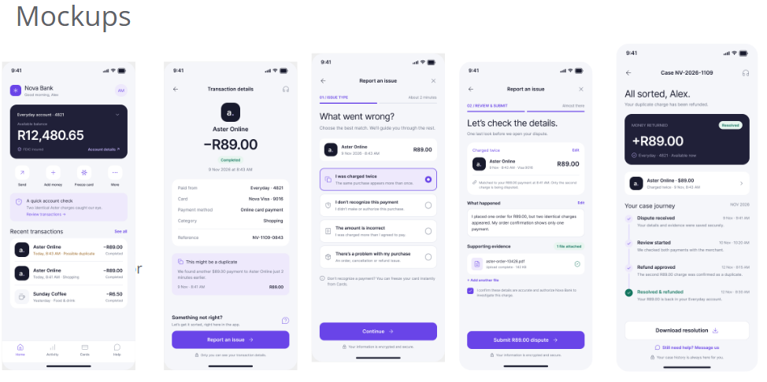
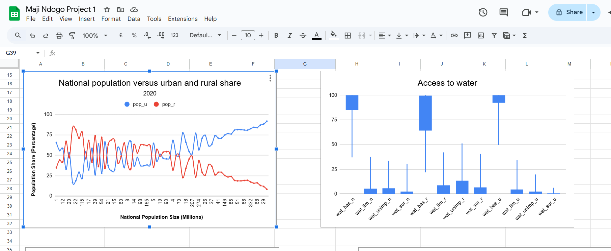

# Portfolio
<!--Section 1: Introduce your self-->
## ABOUT ME

Hello! I'm Belinda Mahachi 😊, a project manager and data analyst with a passion for improving business operations and turning data into actionable insights. With experience across project and product operations, data management, and sales. I help businesses improve operations and unlock growth.

<!--Mention your top/relevant skills here - core and soft skills-->
## WHAT I DO

*I'm currently a product intern at Utern AI, where I work hand in hand with the CMO to improve product marketing operations.*

**- ✅ Project Management.**
I coordinate project activities, timelines, and teams ensuring a smooth execution aligned with project plans. From initiation to project completion, I organize project work, setting priorities, and tracking progress. Proficient in using tools such as Jira, Trello and Asana.

**- ✅ Data Analysis.**
To support project development, I conduct research on relevant topics and analyze data to inform decision-making and strategy. I'm proficient in data cleaning, validation, and visualisation using Excel and SQL.

**- ✅ UX Research and Design.**
I help with product development, from ideation and design to testing and launch with an understanding of users motivations in an agile environment. I have gained experience in different agile frameworks like Scrum and Kanban, participating in sprint planning, reviews and retrospectives.

<!--Section 2: List 3-4 key projects-->
## MY PORTFOLIO 

*A glimpse of some of the projects I've been working on.*

**Predictive Modeling and Hypothesis Testing using Titanic Dataset.**

The sinking of the Titanic is one of the most infamous shipwrecks in history.

[Read More](https://www.linkedin.com/pulse/predictive-modeling-hypothesis-testing-using-titanic-dataset-anietie/)

**Predictive Modeling and Hypothesis Testing using Titanic Dataset.**

On April 15, 1912, during her maiden voyage, the widely considered “unsinkable” RMS Titanic sank after colliding with an iceberg. 

[Read More](https://www.linkedin.com/pulse/predictive-modeling-hypothesis-testing-using-titanic-dataset-anietie/)

**Predictive Modeling and Hypothesis Testing using Titanic Dataset.**

Unfortunately, there weren’t enough lifeboats for everyone onboard, resulting in the death of 1502 out of 2224 passengers and crew. 

<a href="17 How to Present Data to Executives by Anietie Etuk.pdf">Download the Report here (pdf file)</a>

## CONTACT DETAILS

*Let’s connect and see how we can work together!*
<table>
  <tbody>
    <tr>
      <td>📧</td>
      <td><a href="mailto:belindamahachi4@gmail.com">belindamahachi4@gmail.com</a></td>
    </tr>
    <tr>
      <td>📞</td>
      <td>(+27) 67-487-3319</td>
    </tr>
    <tr>
      <td>📍</td>
      <td>Pretoria, South Africa</td>
    </tr>
    <tr>
      <td>⬇️</td>
      <td><a href="https://etuk123456.github.io/portfolio1/docs/Profile.pdf">Download my CV</a></td>
    </tr>
    <tr>
      <td>🌐</td>
      <td><a href="https://linkedin.com/in/belindamahachi">LinkedIn</a></td>
    </tr>
    <tr>
      <td>📺</td>
      <td><a href="https://www.youtube.com/@LearnwithEtuk">Blog</a></td>
    </tr>
  </tbody>
</table>
